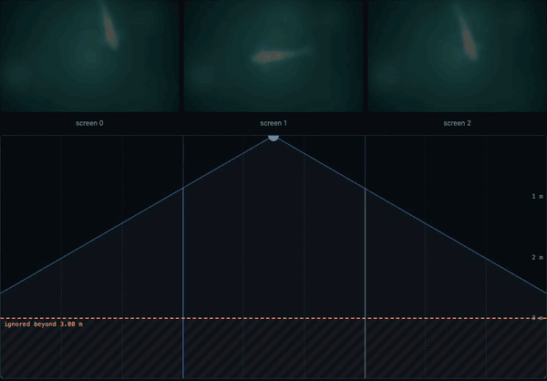

# koi-signage

People-reactive signage on [ohra](https://github.com/hanishi/ohra) actors. A koi lives in a row of
screens side by side (three by default) and reacts to the people in front of them:
- With nobody there, it wanders deep below, faint.
- With one person, it rises and follows them from screen to screen, swimming across the gap.
- With several, it swims toward the busiest screen.



The sensor is an HLK-LD2450 mmWave radar on a Raspberry Pi. Until one is plugged in, the mouse
pointer on a web page stands in for it, so you can try the whole thing with a laptop and any
phones or tablets on the same Wi-Fi. Everything after the sensor is the real code:
- the character's state machine
- the screen-to-screen handoff
- the screens' clock sync

The idea is written up (in Japanese) in
[人に反応するサイネージを、Raspberry Pi とミリ波レーダーで作る構想](https://note.com/programmer_llc/n/nc70f6eca15ee).

## Run

```
uv sync --all-extras
uv run uvicorn --factory koi_signage.app:from_env --host 0.0.0.0 --port 8124
```

- **http://localhost:8124/** shows the screens above the floor.
  - Move the pointer over the floor to walk in.
  - Click to leave someone standing.
  - Move off the floor to leave.
- **http://localhost:8124/?screens=off** is the floor alone. Its **Screen 0/1/2** buttons open
  each screen as its own window, side by side, so the windows stand in for the tablets.
  This is good for the character's logic and for demos. The windows share one clock, so
  sync and latency look perfect here.
- **http://&lt;pi&gt;:8124/screen?n=0** (and `1`, `2`) is one screen, full-window, for a tablet's
  kiosk browser. Any phone, tablet or laptop on the same Wi-Fi works. Separate devices are what
  the sync, latency and kiosk checks need.

`--host 0.0.0.0` lets tablets on the LAN connect. Use `127.0.0.1` to keep it on this machine.
To find the address to type on a phone, run `ipconfig getifaddr en0` (macOS) or `hostname -I`
(Linux), and open `http://<that address>:8124/screen?n=0`.

Line the screens up left to right as 0, 1, 2 (and so on). Any number of devices can show the same
screen number: they mirror each other.

## The koi

A school of five, each a different variety: Taisho Sanke (leading), Kohaku, Showa, Yamabuki Ogon
and Asagi. [`creatives/koi.js`](src/koi_signage/static/creatives/koi.js) draws them on a canvas, from above, about 60 times a
second. There are no image files.
- **Spine:** each koi is a chain of 18 points. The head steers toward a target and each point
  follows the one ahead, so the body bends as it turns. A wave runs down the chain as it swims.
- **Body:** a width profile along the spine gives the outline. The markings are defined in body
  coordinates (along and across), so they bend with it.
- **School:** each koi keeps a place behind the leader, which wanders the screen, and steers away
  from any koi that comes too close.
- **Depth:** the school swims near the surface on its screen and drifts deep, faded into the
  water, while the venue idles.
- **Handoff:** on the leaving screen, each koi reaches the edge at its own moment (the first
  0.9 s after the handoff time, then one every 0.35 s) and its own height. The next screen brings
  the same koi in from the facing edge at that moment and height, on the shared clock, so the
  school swims across one fish at a time.
- **No blur filters:** each canvas blur renders a full-screen layer, too slow for five koi on a
  tablet. Soft edges come from layered translucent strokes.

Change the colours, `halfWidth`, `VARIETIES` or `FORMATION` at the top of `koi.js` for a
different school.

## Making a creative

The school is one creative. `[screen] creative` in `venue.toml` picks which one every screen
shows: `creative = "koi"` loads `src/koi_signage/static/creatives/koi.js`. To make another, add
`creatives/<name>.js`, set `creative = "<name>"` and reload the pages. Static files are read on
every request, so there is no build step and no restart.

A creative is an ES module that exports one function:

```js
export function create(canvas) {
  // draw on canvas, every frame, until the page closes
  return {
    show(state, side) { /* ... */ },
    prepare() { /* ... */ },
  };
}
```

- `create(canvas)` is called once per screen. The canvas fills the screen. Size its backing
  store from `canvas.clientWidth` and `canvas.clientHeight` and keep it in step with them, since
  the same file runs in a small mirror on the floor page and full screen on a tablet.
- `show(state, side)` is called at the moment the screen changes, already on the venue's shared
  clock, so every screen's call lands on the same frame:
  - `"character"`: the character is on this screen now. `side` is `"left"` or `"right"`, the edge
    it comes in through, or `null` when it is placed without a handoff (the first follow, or a
    screen that has just connected).
  - `"blank"`: it has left this screen. `side` is the edge it leaves through.
  - `"idle"`: no one is around, on every screen at once. `side` is `null`.
- `prepare()` is called before a handoff brings the character here. Load what the entrance needs
  and return, or return a promise that settles when it is loaded. The screen tells the character
  it is ready only then, and the handoff waits for it, but for at most `ready_timeout_s` (1 s):
  after that the character moves anyway, so `show` must cope with a load that hasn't finished.

A `"character"` call can follow a `"character"` or `"blank"` call at any time, and either can
arrive without a `prepare()` first, so a creative never assumes an order.

## Actors

| Actor | Does |
|---|---|
| guardian | spawns Character, and a fresh one if it stops |
| Floor (one per floor page) | the pointer as the radar: a `Frame` every 100 ms, at most 3 people |
| Character | idle / follow / crowd, and which screen shows the character. The only one that decides |
| Display (one per screen socket) | commands to its tablet, the tablet's ready back, and clock pings |

The LD2450 actor will replace Floor and send the same `Frame`. The
[design](docs/design.md) maps this tree against the article's.

## Calibration

`venue.toml` holds the number of screens, the floor size, the zone cuts (3 zones per screen) and
every threshold. They are set per site, because a real radar reads off and real people stand in
odd places.

`screens` (default 3) is how many screens stand in the row. Each needs 3 zones, so `zone_cuts_m`
has 3 × screens − 1 cuts, and `width_m` grows with the row: 4 screens at 3 m each is
`screens = 4`, `width_m = 12.0`, `zone_cuts_m = [1, 2, …, 11]`. The pages, the screen sockets and
the character all follow, and so does the radar, which stays in the middle. One radar covers
less of a longer row, and the floor page shows where it can't see.

The server reads `$VENUE` if it is set, otherwise `venue.toml` in the directory it starts in,
otherwise the defaults that ship with the package
([`src/koi_signage/venue.toml`](src/koi_signage/venue.toml)). To make your own, copy the
defaults and edit them:

```
cp "$(python -c 'from koi_signage.venue import DEFAULT_VENUE; print(DEFAULT_VENUE)')" venue.toml
```

`max_distance_m` (default 3 m) is how far from the screens someone can be and still count.
Someone walking past along the far wall doesn't wake the character. The slider under the floor
changes it live for that page's connection. The floor shows the cut-off as a dashed line and dims
anyone beyond it. Copy a value you like into `venue.toml`: a restart starts from the file again.

`[screen] creative` (default `"koi"`) is what the screens show: see
[Making a creative](#making-a-creative).

`[radar]` is the LD2450's view: where it sits on the screen line (the middle of the floor unless
`x_m` says otherwise), its range (6 m) and its field of view (120°, ±60° from straight out). Only what is inside that sector counts. The floor page
shades everything outside it. With one sensor in the middle, people standing close to the side
screens are out of its view: about 1.7 m out in front of the middle of screen 0 or 2 is the
nearest it sees them.

## Not yet

| Left out | Add when |
|---|---|
| Uplink, Outbox, CreativeCache (Promovolve) | the HTTPS contract with Promovolve is agreed |
| Operator agent (ohra-agents) | this runs and the agent is still wanted |
| LD2450 UART sensor | the radar arrives |
| Follow cap (the creepiness mitigation) | after a first walk-through |
| Walking-speed lead on the handoff time | latency is measured on tablets |
| Loop-lag metric | it runs on the Pi |
| Real creatives: the character is a drawn koi (`static/creatives/koi.js`) | Promovolve supplies assets |

## Contributing

See [CONTRIBUTING.md](CONTRIBUTING.md) for the checks, how the tests are written, and the rules
the code keeps.

## License

[Apache-2.0](LICENSE)
